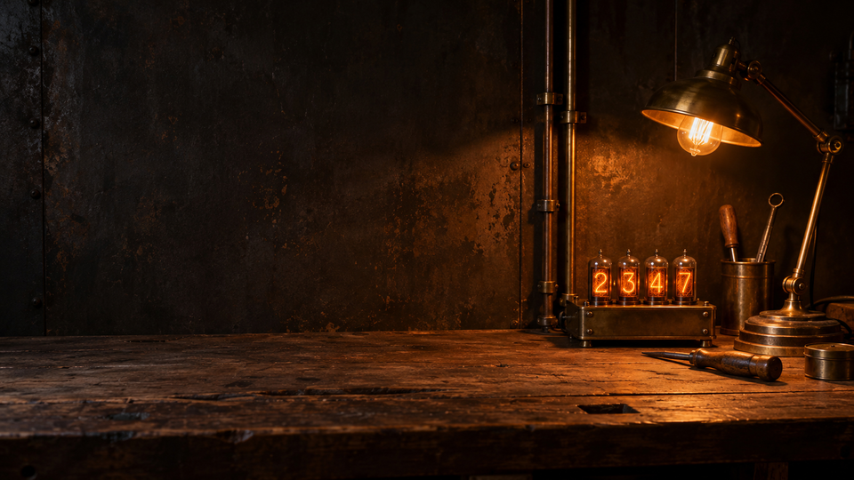
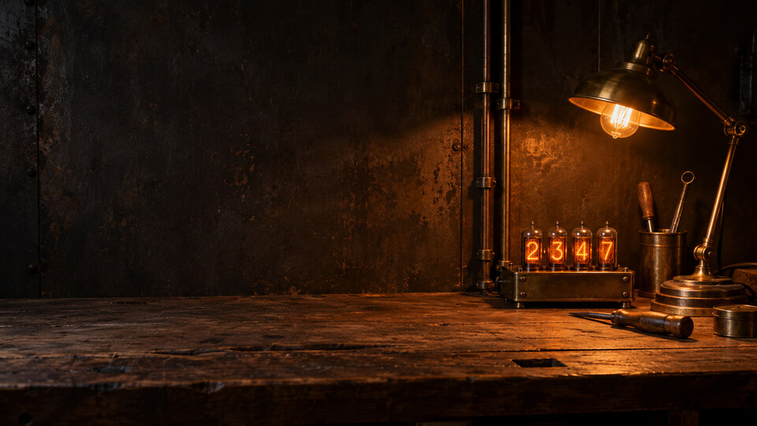
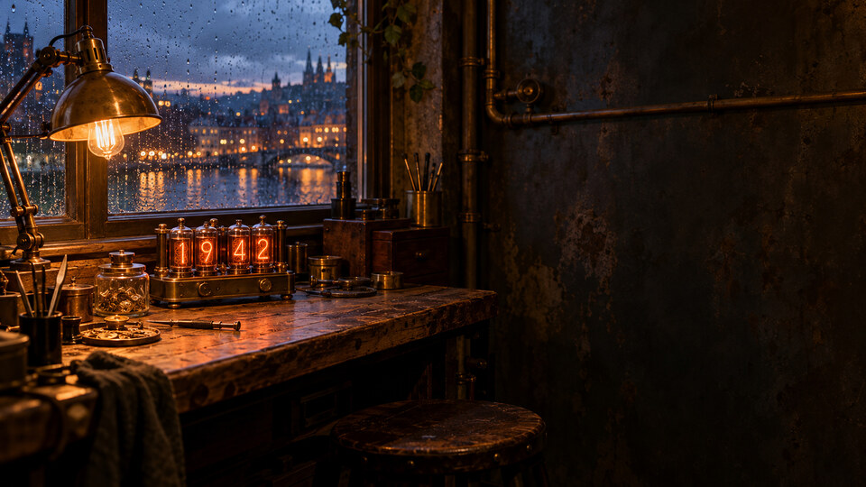
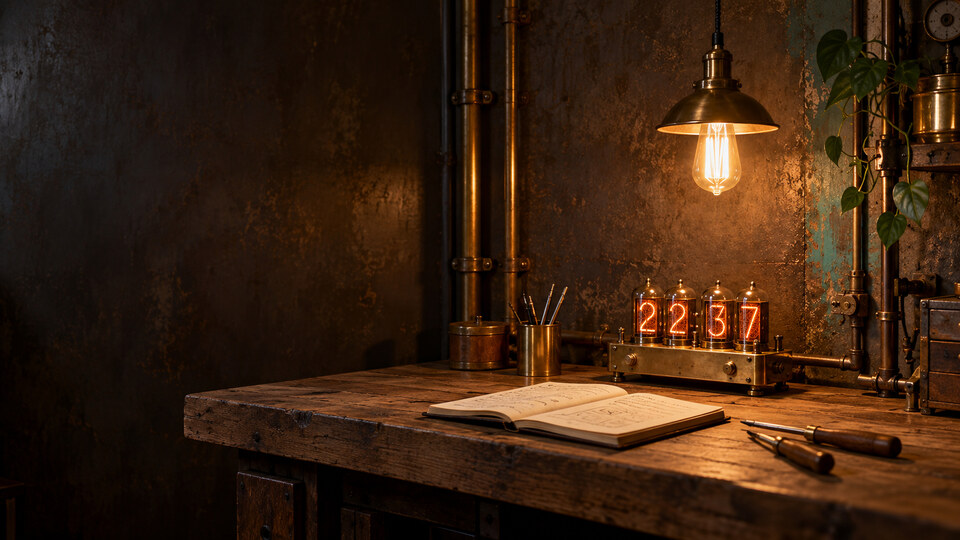

# Ember Foundry for Omarchy

A dark steampunk theme with warm steel, aged brass, and softly glowing nixie tubes. The photorealistic wallpapers show a small, cozy workshop with a few tools and filament lamps.



## Install

```bash
omarchy theme install https://github.com/cbrompton/omarchy-ember-foundry.git
```

Omarchy installs the repository as `ember-foundry` and applies it. To switch back later, run `omarchy theme set ember-foundry`.

## Choose a wallpaper

Omarchy starts with **A — Nixie workbench**. Run `omarchy theme bg next` to cycle through the three 4K-size options.

### A — Nixie workbench

[](backgrounds/01-nixie-workbench-4k.jpg)

An uncluttered steel wall, oak bench, brass pipes, nixie clock, and desk lamp. [4K-size wallpaper](backgrounds/01-nixie-workbench-4k.jpg) · [3440 × 1440 ultrawide crop](ultrawide/01-nixie-workbench-3440x1440.jpg)

### B — Rainy workshop

[](backgrounds/02-rainy-workshop-4k.jpg)

A warm bench and nixie clock beside a rain-speckled dusk window. [4K-size wallpaper](backgrounds/02-rainy-workshop-4k.jpg) · [3440 × 1440 ultrawide crop](ultrawide/02-rainy-workshop-3440x1440.jpg)

### C — Lamplit nook

[](backgrounds/03-lamplit-nook-4k.jpg)

A small workbench, notebook, clock, and hanging filament lamp. [4K-size wallpaper](backgrounds/03-lamplit-nook-4k.jpg) · [3440 × 1440 ultrawide crop](ultrawide/03-lamplit-nook-3440x1440.jpg)

To use an ultrawide crop after installation, run `omarchy theme bg set` with its path. For example:

```bash
omarchy theme bg set "$HOME/.config/omarchy/themes/ember-foundry/ultrawide/01-nixie-workbench-3440x1440.jpg"
```

The generated images are 1672 × 941 pixels. The 3840 × 2160 files are high-quality upscales, and the ultrawide files are center crops of those upscales. They have the requested pixel dimensions but do not contain native 4K detail.

## Theme files

- [`colors.toml`](colors.toml) defines the dark steel palette and glowing amber accent. Omarchy generates its terminal, shell, and app colors from it.
- [`icons.theme`](icons.theme) selects Yaru's warm brown icon variant.
- [`preview.png`](preview.png) provides a theme picker preview.

Foreground text has an 11.3:1 contrast ratio against the main background; the amber accent has a 7.7:1 ratio.

## Artwork

All three wallpapers were made with the built-in image generator. The prompts asked for editorial interior photography of a small, quiet steampunk workshop centered on a brass nixie tube clock, a few tools, filament light, and brass pipes. They specified realistic camera optics, physically plausible materials and lighting, restrained amber color, no people, no logos, no franchise imagery, and no illustrated or CGI appearance. The variants change the framing: a simple bench with negative space, a rainy dusk window, and a lamplit work nook.

## License

MIT. See [LICENSE](LICENSE).
